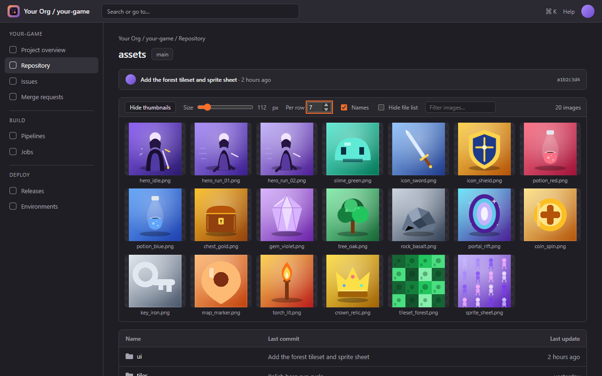
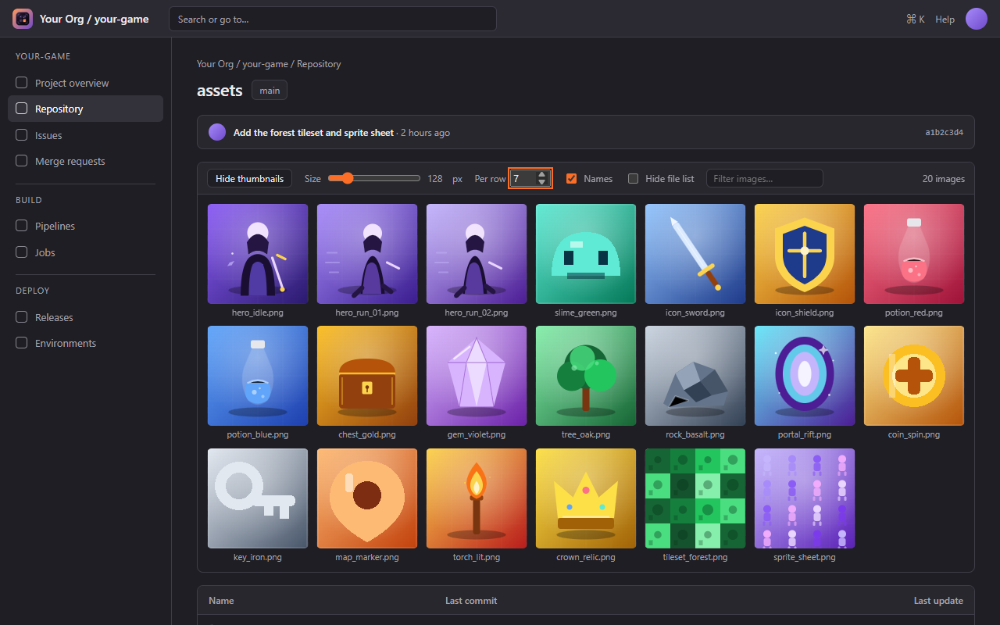
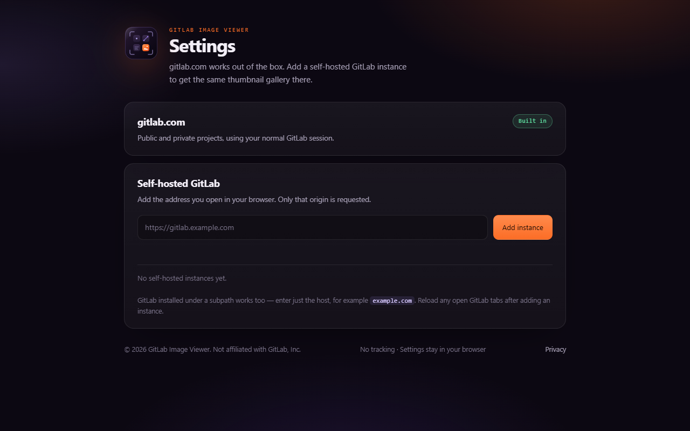

<p align="center">
  
</p>

<h1 align="center">GitLab Image Viewer</h1>

<p align="center">
  <b>See every image in a GitLab folder as a thumbnail gallery.</b><br>
  A free, open-source Chrome extension that previews PNG, JPG, GIF, SVG, WebP and AVIF files in GitLab repositories without opening them one by one. Works with gitlab.com and self-hosted GitLab.
</p>

<p align="center">
  <a href="https://AutomationXpert.github.io/Gitlab-Image-Viewer/"><b>Website</b></a> ·
  <a href="https://github.com/AutomationXpert/Gitlab-Image-Viewer/releases/latest"><b>Download</b></a> ·
  <a href="#install">Install</a> ·
  <a href="#self-hosted-gitlab">Self-hosted</a> ·
  <a href="#faq">FAQ</a>
</p>

<p align="center">
  
  
  
  
  
</p>



## Why

On GitLab, a folder of images is just a list of file names. If you work with game assets, sprite sheets, icon sets, screenshots, UI mockups or dataset samples, you end up opening files one at a time to see what they are. GitLab Image Viewer adds a **thumbnail grid** above the file list, so you can see the whole folder at once.

## Features

- **Thumbnail grid** for every image in the current folder: PNG, JPG/JPEG, GIF, SVG, WebP, AVIF, BMP and ICO.
- **Adjustable thumbnail size** from 48 px to 512 px.
- **Images per row**: set an exact column count, or 0 to fit as many as the size allows.
- **Full-size lightbox**: click a thumbnail to view it large, with its pixel dimensions. Use ← and → to browse, Home/End to jump, and Esc to close. Small pixel art is scaled up without blurring.
- **Show or hide file names**, and optionally **hide GitLab's file list** to see only the gallery.
- **Filter as you type** to find one sprite in a folder of hundreds.
- **Works on private projects** through your normal GitLab session. No token or OAuth.
- **Self-hosted GitLab supported**: add your instance's address on the settings page.
- **Follows GitLab's light and dark themes.**
- **Fast on large folders**: thumbnails load lazily as you scroll.
- **Private by design**: no analytics, no servers. Only your grid settings and instance list are stored, in your browser.
- Ctrl-click or middle-click a thumbnail to open GitLab's file page in a new tab.

| Fixed images per row | Lightbox |
| --- | --- |
|  |  |

## Install

The Chrome Web Store listing is on its way. Until it is live, install it from GitHub:

1. Download the latest `gitlab-image-viewer-*.zip` from [Releases](https://github.com/AutomationXpert/Gitlab-Image-Viewer/releases/latest) and unzip it, or clone this repository.
2. Open `chrome://extensions` (Edge: `edge://extensions`, Brave: `brave://extensions`).
3. Turn on **Developer mode**.
4. Click **Load unpacked** and select the `extension` folder.
5. Open any folder on gitlab.com that contains images.

## Self-hosted GitLab

gitlab.com works out of the box. For your own instance:

1. Click the extension icon, or open the extension's **Options** page.
2. Enter your GitLab address, for example `https://gitlab.example.com` or `https://example.com/gitlab` if GitLab lives under a subpath.
3. Click **Add instance** and approve the browser's permission prompt for that origin.
4. Open a repository folder on that instance. The grid appears there too.

The extension requests access to that one origin only. Remove an instance on the same page to revoke it; the browser's extension settings can also revoke access at any time.

| Settings page |
| --- |
|  |

## FAQ

**How do I see image thumbnails in a GitLab repository?**
Install GitLab Image Viewer and open a folder on gitlab.com or your self-hosted instance. All images in that folder appear as a grid above the file list.

**Does it work with self-hosted GitLab?**
Yes. Add the instance on the settings page, approve the origin, and the grid works there like it does on gitlab.com.

**Does it work with private projects?**
Yes. Images load through your normal GitLab browser session, so anything you can open while signed in also shows as a thumbnail.

**Does it collect data?**
No. See the [privacy policy](https://AutomationXpert.github.io/Gitlab-Image-Viewer/privacy.html).

**Why do I only see images from one folder?**
The grid shows the folder you are viewing. GitLab paginates very large folders, and the grid follows the rows GitLab has rendered.

**Which browsers are supported?**
Chrome, Edge, Brave, Opera, Vivaldi and other Chromium-based browsers (Chrome 102+).

## Project layout

```
extension/   the browser extension (Manifest V3): manifest.json, content.js, content.css,
             background.js, shared.js, options.*, icons/
docs/        landing page, served by GitHub Pages
store/       Chrome Web Store listing text and images
tools/       Playwright script that renders icons, store art and screenshots
```

## Development

The extension has no build step: it is plain JavaScript loaded unpacked.

```bash
npm install     # only needed for the asset pipeline
npm run assets  # re-renders icons, promo images and screenshots
```

`tools/render-assets.mjs` rasterizes `docs/assets/icon.svg`, renders the promo art, and screenshots the real extension against a mocked GitLab tree page.

## Contributing

Issues and pull requests are welcome. If GitLab changes its page layout and the grid stops appearing, please [open an issue](https://github.com/AutomationXpert/Gitlab-Image-Viewer/issues) with the URL of the folder (or a description of the page structure if the project is private).

## License

[MIT](LICENSE). Not affiliated with or endorsed by GitLab, Inc. GitLab is a trademark of GitLab Inc.

---

<sub>Keywords: GitLab image viewer, GitLab thumbnails, GitLab image preview, GitLab gallery view, view images in a GitLab repo, GitLab folder thumbnails, self-hosted GitLab image browser, sprite sheet viewer, game asset browser, Chrome extension for GitLab.</sub>
